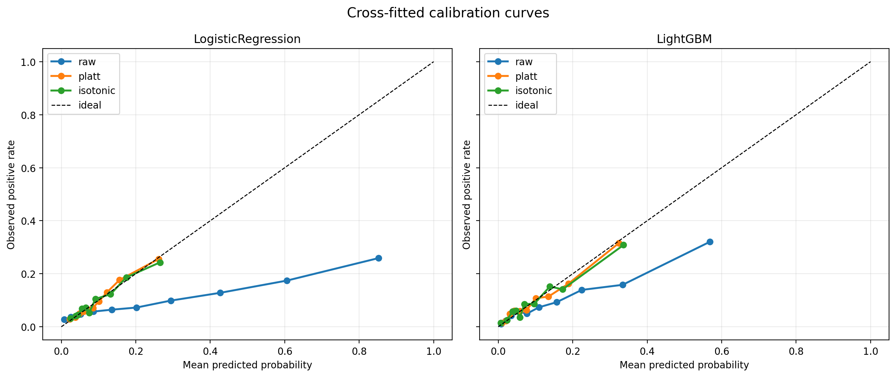

# RD-Agent Reliability Study

A reproducible study of the reliability, auditability, and statistical evaluation of autonomous data-science agents.

## Project Overview

This project investigates whether machine-learning pipelines proposed by RD-Agent remain credible when evaluated under a stricter, independently implemented experimental framework.

The first case study uses a 12-hour acute respiratory failure (ARF) prediction task. It is a study of automated data-science reliability, not a clinical deployment study.

The work consists of two stages:

1. **ARF V1:** runs RD-Agent, inspects its generated pipeline, and conducts baseline, ablation, robustness, feature-importance, threshold, and error analyses.
2. **ARF V2:** independently audits the modeling direction using fixed data splits, nested cross-validation, automated tests, integrity checks, and statistical uncertainty analysis.

ARF V2 is an independent evaluation layer. Its nested cross-validation, statistical analysis, and automated tests were implemented separately rather than being presented as direct RD-Agent output.

## Key Findings

Under the same fixed outer splits and 12-hour sum features, LightGBM outperformed logistic regression in AUROC and Average Precision in all five outer folds.

| Model | Mean fold AUROC | Mean fold AP | Pooled OOF AUROC | Pooled OOF AP |
|---|---:|---:|---:|---:|
| Logistic Regression | 0.7080 | 0.2349 | 0.7077 | 0.2288 |
| LightGBM | 0.7758 | 0.3201 | 0.7537 | 0.3017 |

Mean paired improvements were `+0.0677` in AUROC and `+0.0852` in Average Precision. The approximate corrected 95% intervals were `[0.0298, 0.1056]` for the AUROC difference and `[0.0154, 0.1549]` for the Average Precision difference.

The exact two-sided sign-test result was:

```text
p = 0.0625
```

With only five paired folds, this is the smallest attainable two-sided sign-test p-value. The result demonstrates a consistent direction but is not presented as conventional `p < 0.05` significance. The corrected intervals are approximate, depend on assumptions about cross-validation dependence, and do not replace external validation.

This result is consistent with the possibility that LightGBM benefits from nonlinear modeling and feature interactions in high-dimensional sparse clinical data. It does not, however, establish a causal explanation for the performance difference.

Cross-fitted Platt scaling and isotonic regression were evaluated without using each target outer fold for fitting its calibrator or selecting its threshold.

| Model | Raw Brier | Platt Brier | Raw ECE | Platt ECE |
|---|---:|---:|---:|---:|
| Logistic Regression | 0.1515 | 0.0821 | 0.1783 | 0.0069 |
| LightGBM | 0.0887 | 0.0790 | 0.0654 | 0.0116 |

The observed positive rate was 9.68%. The raw mean predicted probabilities were higher than this rate. After Platt scaling, the mean predicted probabilities were approximately 9.68% for logistic regression and 9.88% for LightGBM.

| Threshold policy for raw LightGBM probabilities | Sensitivity | Specificity | Precision | Predicted-positive rate |
|---|---:|---:|---:|---:|
| Fixed 0.5 | 0.2594 | 0.9575 | 0.3952 | 0.0635 |
| Youden J | 0.6823 | 0.6843 | 0.1880 | 0.3512 |
| Target sensitivity 0.80 | 0.7844 | 0.5368 | 0.1535 | 0.4943 |
| Target sensitivity 0.90 | 0.8917 | 0.3682 | 0.1313 | 0.6570 |

Increasing sensitivity required a substantially larger false-positive and review burden; no threshold is presented as universally optimal.



This remains an internal cross-fitted analysis and does not replace external calibration or prospective validation. The results support a relative model comparison under the current experimental design. They do not establish clinical deployment readiness, external generalizability, or externally validated clinical risk probabilities.

## Reports and Artifacts

The public release includes the final English reports for both project stages:

- [ARF V1 Project Report](reports/ARF-V1-Project-Report-English.pdf)
- [ARF V2 Reliability Report](reports/ARF-V2-Reliability-Report-English.pdf)

The archived ARF V1 directory retains the associated code, figures, and aggregate result tables. Detailed report descriptions are available in [reports/README.md](reports/README.md).

Important public artifacts are protected by SHA256 integrity records. Verify them with:

```bash
python scripts/verify_public_release.py
```

This dependency-free check verifies every checksummed public artifact. It reports the raw-data and generated-split checksum records as expected skips because those inputs are intentionally not published.

GitHub Actions also installs the published dependencies and runs the 13 tests that require only released configuration and aggregate artifacts. The remaining tests are retained as part of the recorded 32-test project suite but require authorized raw data, sample-level splits, or individual-level OOF predictions that are intentionally excluded from this public release.

## Data and Reproduction Boundary

This repository is published with permission from the internship project supervisor. The ARF reference task data are distributed separately through the [RD-Agent data-science documentation](https://github.com/microsoft/RD-Agent/blob/main/docs/scens/data_science.rst) and are not mirrored here. Users should obtain the data from that source and follow its applicable terms. No credentials or access instructions for internal systems are included.

The task predicts whether acute respiratory failure will occur within the following 12 hours using 12 hours of multivariate ICU observations.

| Item | Value |
|---|---:|
| Samples | 9,921 |
| Positive samples | 960 |
| Negative samples | 8,961 |
| Positive rate | 9.68% |
| Original tensor shape | `(9921, 12, 4816)` |
| Audited feature representation | 4,816-dimensional 12-hour sum features |

Raw medical data, generated feature matrices, individual-level out-of-fold predictions, individual error-case tables, API keys and `.env` files, model caches, temporary RD-Agent workspaces, complete execution logs, and large bootstrap distributions are not included. The split file is also excluded because it contains sample-level task identifiers.

To reproduce the released analyses, obtain the authorized data independently, set `ARF_DATA_DIR`, generate the fixed outer splits locally, and verify the raw data against the provided SHA256 records. The repository does not itself provide the raw data or a clinical-use workflow. Although the split file contains dataset IDs rather than names or direct personal identifiers, any further distribution must comply with the dataset license and applicable data-governance requirements.

## Research Design and Interpretation

This repository examines:

- whether an RD-Agent-derived modeling direction survives stricter independent evaluation;
- whether parameter selection is properly separated from final evaluation;
- whether model comparisons remain consistent across validation folds;
- how much uncertainty exists in the reported performance differences;
- which failures require human intervention; and
- which experiment artifacts can be reproduced and audited.

ARF V2 uses a fixed five-fold stratified outer split, three-fold inner cross-validation for parameter selection, identical outer folds for all models, out-of-fold predictions, AUROC as the primary metric, Average Precision and Brier score as secondary metrics, paired fold analysis, and stratified OOF bootstrap as a supplementary uncertainty analysis.

The current implementation includes automated checks for tensor structure, label distribution, ID uniqueness, split integrity, data/split alignment, sparse feature construction, experiment configuration, out-of-fold prediction completeness, probability validity, metric reproduction, and inner parameter-selection correctness. The recorded project test result is `32 passed`.

## Development and validation

I designed the experiment, reviewed and revised the final implementation and analyses, and validated the reported results. AI assisted with early code scaffolding.

## Repository Structure

```text
rdagent-reliability-study/
├── archive/
│   └── arf_v1/              Archived ARF V1 artifacts
├── configs/                 Versioned experiment configurations
├── data/
│   ├── checksums/           Data and artifact integrity records
│   └── splits/              Local generated splits, excluded from Git
├── reports/                 Final English research reports
├── results/
│   ├── figures/             Selected aggregate figures
│   ├── logs/                Local logs, excluded from Git
│   └── tables/              Aggregate result tables
├── src/
│   ├── data/                Validated data loaders
│   ├── evaluation/          Statistical evaluation code
│   └── experiments/         Experiment runners
├── tests/                   Automated integrity and output tests
├── LICENSE
├── NOTICE.md
└── README.md
```

## Setup and Verification

Create a compatible environment and install the pinned packages:

```bash
conda create -n rdagent python=3.10
conda activate rdagent
python -m pip install -r requirements.txt
```

The pinned runtime packages match the archived ARF V2 experiment environment. The exact `pytest` version was not recorded because it is used only for the repository test suite, not for model execution.

Configure the externally obtained training data:

```bash
export ARF_DATA_DIR=/path/to/arf-12-hours-prediction-task/train
```

The directory must contain:

```text
ARF_12h.csv
X.npz
```

If `ARF_DATA_DIR` is not set, the loader uses the local default path under `~/projects/RD-Agent/git_ignore_folder/ds_data/`.

Generate local splits, run checks, and reproduce the released analyses:

```bash
python scripts/generate_arf_outer_splits.py
python -m pytest -q
python -m src.experiments.run_nested_cv
python -m src.evaluation.uncertainty_analysis
python -m src.evaluation.calibration_threshold_analysis
python scripts/verify_public_release.py
```

The checksum record for the generated outer-split file can be verified after split generation.

## Experimental Environment

The recorded experiments used Ubuntu 24.04 LTS, ARM64 / aarch64, Python 3.10.20, NumPy 2.2.6, pandas 2.3.3, SciPy 1.14.1, scikit-learn 1.7.2, LightGBM 4.7.0, and an RD-Agent installation from source. The archived environment record is [archive/arf_v1/environment.txt](archive/arf_v1/environment.txt).

## Limitations

- No independent hospital dataset was available for external validation.
- Patient-level identifiers were unavailable.
- Only one fixed outer five-fold split has been evaluated in ARF V2.
- Hyperparameter grids were intentionally limited.
- The selected feature representation was informed by earlier ARF V1 experiments.
- Features are anonymized, limiting clinical interpretation.
- Cross-fitted internal calibration was completed, but external calibration on an independent hospital or temporal cohort remains unavailable.
- The OOF bootstrap does not reproduce the complete model-training process.
- The exact sign test has limited power with only five paired folds.
- Results must not be interpreted as evidence of clinical deployment readiness.

This repository is intended solely for educational, software-reliability, and machine-learning research purposes. It must not be used for medical diagnosis, treatment decisions, or clinical deployment.

## Project Status

Completed: RD-Agent ARF pipeline generation, independent baseline construction, feature ablation, multi-seed robustness analysis, feature-importance analysis, threshold and error analysis, fixed outer-fold construction, nested cross-validation, automated result auditing, statistical uncertainty analysis, cross-fitted probability calibration, and threshold-policy evaluation.

Planned next stage: controlled repeated RD-Agent runs; a success and failure taxonomy; retry and intervention measurement; runtime and cost analysis; output-format reliability analysis; and cross-task or cross-dataset validation.

## License and Material Use

Project-authored code is available under the [MIT License](LICENSE). The [notice](NOTICE.md) defines the separate treatment of reports, datasets, and third-party materials.
